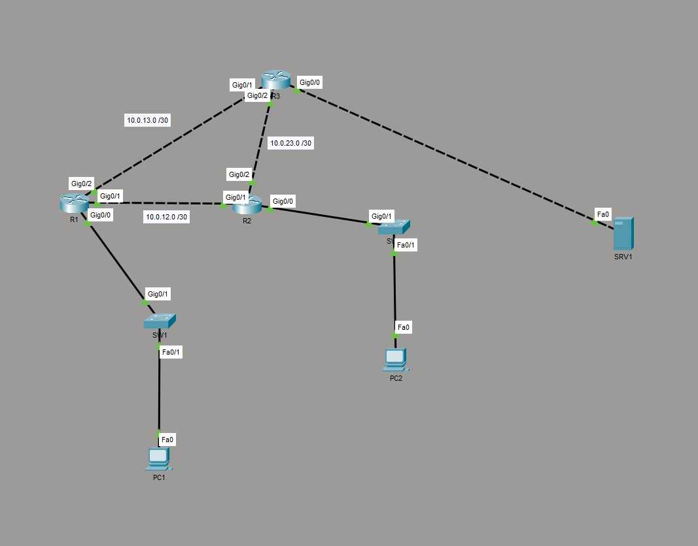

# Lab 02 — Multi-Protocol Routing (Static, Floating Static, OSPF & EIGRP)

## Scenario & Objectives
Design and implement a 3-router enterprise WAN connecting an HQ LAN, a Branch Office, a DMZ Server, and a simulated Internet destination (`8.8.8.8/32`) with dynamic routing, path failover, and Administrative Distance (AD) route selection.

## Network Topology

## IP Addressing Table

| Device | Interface | IP Address / Mask | Role |
| :--- | :--- | :--- | :--- |
| **R1 (HQ)** | `Gig0/0` | `192.168.10.1/24` | HQ LAN Gateway (`PC1`) |
| **R1 (HQ)** | `Gig0/1` | `10.0.12.1/30` | Point-to-Point Link to R2 |
| **R1 (HQ)** | `Gig0/2` | `10.0.13.1/30` | Point-to-Point Link to R3 |
| **R2 (Branch)** | `Gig0/0` | `192.168.20.1/24` | Branch LAN Gateway (`PC2`) |
| **R2 (Branch)** | `Gig0/1` | `10.0.12.2/30` | Point-to-Point Link to R1 |
| **R2 (Branch)** | `Gig0/2` | `10.0.23.1/30` | Point-to-Point Link to R3 |
| **R3 (Core/ISP)** | `Gig0/0` | `172.16.100.1/24` | DMZ Gateway (`Server1`) |
| **R3 (Core/ISP)** | `Gig0/1` | `10.0.13.2/30` | Point-to-Point Link to R1 |
| **R3 (Core/ISP)** | `Gig0/2` | `10.0.23.2/30` | Point-to-Point Link to R2 |
| **R3 (Core/ISP)** | `Loopback0` | `8.8.8.8/32` | Simulated Internet Host |

## Key Technologies Implemented
- **OSPFv2 Single-Area (Area 0):** Configured across `R1`, `R2`, and `R3` with manual Router-IDs (`1.1.1.1`, `2.2.2.2`, `3.3.3.3`), `passive-interface` on LAN links, and `ip ospf network point-to-point` on inter-router links to bypass unnecessary DR/BDR election.
- **Default & Floating Static Routes:** Configured a primary default route on `R1` via `R3` (AD `1`) and a backup Floating Static Route via `R2` (AD `10`), verified by shutting down `R1 Gig0/2` and tracing the rerouted path to `8.8.8.8`.
- **EIGRP AS 100 & Administrative Distance:** Enabled EIGRP (`no auto-summary`) between `R1` and `R2` to verify that EIGRP (AD `90`) takes precedence over OSPF (AD `110`) for `192.168.20.0/24` while OSPF remains active for `172.16.100.0/24`.
- **Break-Fix Troubleshooting Verified:** Tested OSPF Hello/Dead timer mismatch (`ip ospf hello-interval`) and EIGRP `passive-interface` misconfiguration with automatic fallback to OSPF.

## Verification Commands Used
- `show ip route`
- `show ip ospf neighbor`
- `show ip eigrp neighbors`
- `show ip protocols`
- `ping` / `tracert 8.8.8.8` (primary & failover paths)

## Configuration Files
- [R1 Running Config](./R1_config.txt)
- [R2 Running Config](./R2_config.txt)
- [R3 Running Config](./R3_config.txt)
