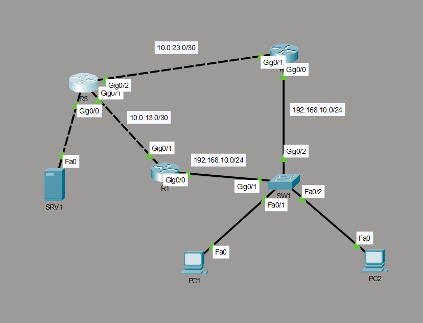

# Lab 03 — Gateway Redundancy (HSRP), IPv6 Dual-Stack & Extended ACL

## Scenario & Objectives
Design and deploy a redundant enterprise LAN gateway using HSRP, enable Dual-Stack IPv4/IPv6 routing to a DMZ server, and enforce granular Layer 4 security policies using Extended ACLs consistently across both Active and Standby routers.

## Network Topology

## IP Addressing Table (Dual-Stack)

| Device | Interface | IPv4 Address / Mask | IPv6 Address / Prefix | Role |
| :--- | :--- | :--- | :--- | :--- |
| **Virtual GW** | `HSRP Group 10` | `192.168.10.1/24` | — | Redundant LAN Gateway |
| **R1 (Active)** | `Gig0/0` | `192.168.10.2/24` | `2001:db8:10::1/64` | HSRP Priority `110`, `preempt` |
| **R1 (Active)** | `Gig0/1` | `10.0.13.1/30` | `2001:db8:13::1/64` | Point-to-Point Link to R3 |
| **R2 (Standby)** | `Gig0/0` | `192.168.10.3/24` | — | HSRP Priority `100` (Default) |
| **R2 (Standby)** | `Gig0/1` | `10.0.23.1/30` | — | Point-to-Point Link to R3 |
| **R3 (Core/DMZ)** | `Gig0/0` | `172.16.100.1/24` | `2001:db8:100::1/64` | DMZ Gateway (`Server1`) |
| **R3 (Core/DMZ)** | `Gig0/1` | `10.0.13.2/30` | `2001:db8:13::2/64` | Link to R1 |
| **R3 (Core/DMZ)** | `Gig0/2` | `10.0.23.2/30` | — | Link to R2 |
| **PC1 (Admin)** | `Fa0` | `192.168.10.10/24` | `2001:db8:10::10/64` | Full access to DMZ |
| **PC2 (User)** | `Fa0` | `192.168.10.20/24` | — | HTTPS-only to `Server1` |
| **Server1 (DMZ)** | `Fa0` | `172.16.100.10/24` | `2001:db8:100::10/64` | Web Server (HTTP/HTTPS) |

## Key Technologies Implemented
- **HSRP (Group 10) + OSPFv2 Area 0:** Configured redundant first-hop gateway (`192.168.10.1`) across `R1` (Active, priority `110`, `preempt`) and `R2` (Standby), paired with OSPF across `R1–R3` so return traffic reroutes automatically during gateway failover.
- **IPv6 Dual-Stack Routing:** Enabled `ipv6 unicast-routing` and static IPv6 routing between `R1` and `R3`, verifying end-to-end IPv6 connectivity (`PC1` to `Server1`) alongside IPv4.
- **Extended ACL (`101`) Enforcement:** Applied inbound on `Gig0/0` of both `R1` and `R2` (closest to the source) to allow `PC2` strictly HTTPS (`TCP 443`) to `Server1`, block all other `PC2` traffic (HTTP, ICMP) to `Server1`, and permit `PC1` and control traffic (`permit ip any any`).

## Verification Commands Used
- `show standby brief`
- `show ip route` / `show ipv6 route`
- `show access-lists`
- `tracert 172.16.100.10` (primary & HSRP failover path)
- `ping 2001:db8:100::10` (IPv6 end-to-end)
- Browser tests from `PC1` and `PC2` (`http://` vs `https://172.16.100.10`)

## Configuration Files
- [R1 Running Config](./R1_config.txt)
- [R2 Running Config](./R2_config.txt)
- [R3 Running Config](./R3_config.txt)
